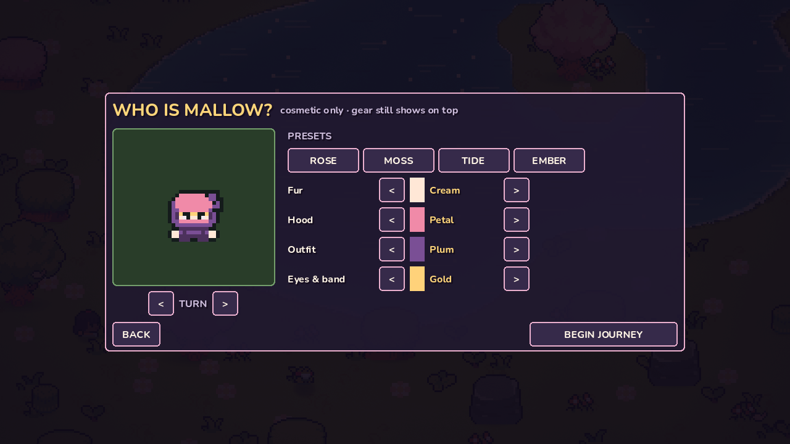
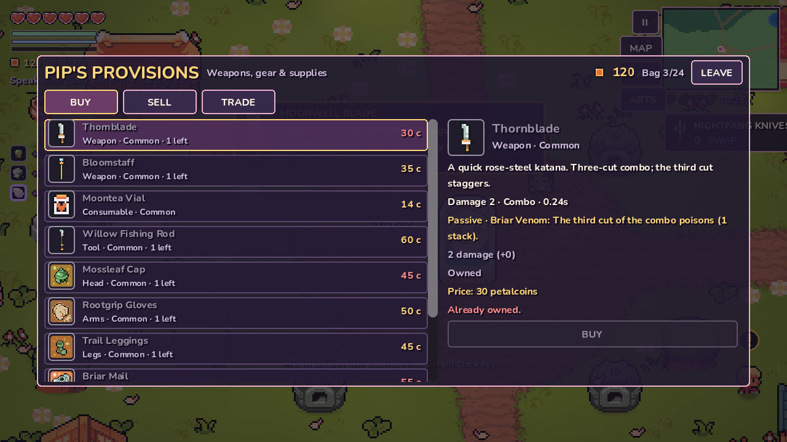
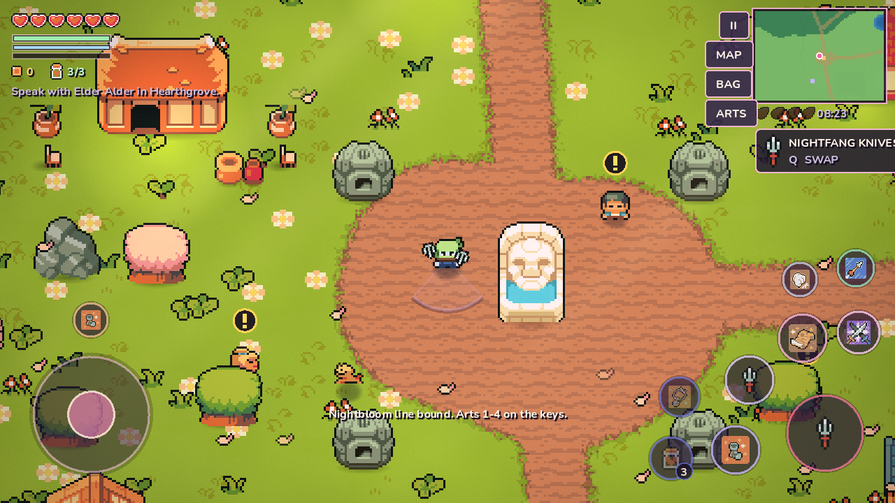
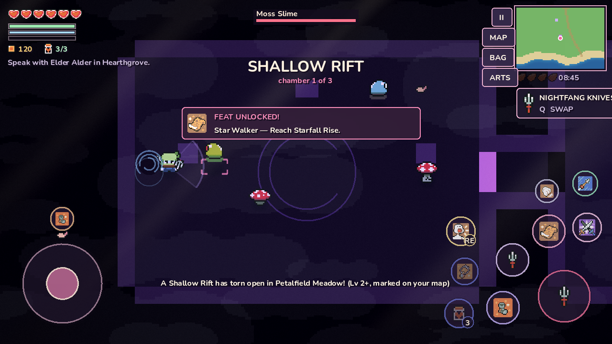

# Petalbound

An offline, landscape **open-world pixel-art action adventure** for Godot 4 (Android first, keyboard and gamepad supported). Mallow, a rose-haired wanderer in a plum cloak, sets out from the lantern village of Hearthgrove across a 4,864 × 2,816 px valley of seven biomes. The goal is to win back four Moonseeds from the region guardians, wake the dimming Moonwell — and then, if you dare, climb down into the Blighted Depths.


| | |
| --- | --- |
|  |  |
|  |  |

## Play

Open `project.godot` in Godot 4.3 or newer (validated on 4.7.2). The game uses the **Compatibility renderer**, a 640×360 pixel viewport (aspect expand), and sensor landscape orientation.

| Action | Keyboard | Gamepad | Touch |
| --- | --- | --- | --- |
| Move | WASD / arrows | Left stick / D-pad | Joystick (lower left) — floating or fixed, see Settings |
| Sprint (uses stamina) | Shift | L2 | SPRINT button, or push the stick to its edge |
| Jump (hop low props, plunge attack) | C / L | Y | Jump button |
| Basic attack (fists when unarmed; hold to repeat; the stick steers each swing) | J / Enter (hold) | A / X | Large weapon button (hold) |
| Arts slots 1-4 (tap arts fire at once; aimed arts smart-cast) | 1 · 2 · 3 · 4 | – | Four art buttons: tap, or drag to aim and release; slide back onto the button to cancel |
| Gear active (from the worn relic/gear, not an art slot) | V / 5 | – | Gear-active button (always shown; dim socket when nothing grants one) |
| Potion (Moontea charges, then Moontea Vials from the bag) | R | – | Potion button (count badge) |
| Mothlight · Petalguard (also slottable arts) | F · G | L1 · R2 | Art slots |
| Lock / cycle target | T, or click an enemy | – | Tap an enemy (tap again to unlock) |
| Petal Arts (loadout, upgrades, lines) | K | – | ARTS button, or tap an empty art slot |
| Journeys (quest log) | H | – | Pause menu → ARTS page |
| Swap weapon | Q / Tab | R1 | Weapon button |
| Talk / open / rest / gather / fish | E | A | Context button |
| Crafting screen (field recipes anywhere, forge recipes at Bramble) | U | – | Talk to Bramble |
| Satchel (inspect, compare, equip) · World map | I / B · M | Select | BAG · MAP |
| Photo mode (drag to pan, zoom, capture) | F9 | – | Pause menu → PHOTO MODE |
| Pause / settings / HUD editor | Esc / P | Start | ❚❚ |

## Open-world expansion (2026-10-13)

| | |
| --- | --- |
|  |  |
|  |  |

- **Start bare-pawed.** New journeys begin with no weapon: Mallow punches (short 3-jab combo with a small attack indicator, no held-weapon sprite). Equipping a weapon changes the attack, indicator and the sprite in Mallow's paw immediately; **UNEQUIP** in the satchel returns to punching. The intro journeys (First Fists → Pocket the Spoils → Market Day → Arm Yourself → Petal Arts → Over the Hill) teach punching, loot, the shop, equipping, arts and exploring, and pay enough to buy a first weapon.
- **Attack direction.** Holding attack repeats swings with a 0.22s input buffer; every swing re-reads the stick. A deliberate stick direction always wins over the auto-target; a stick within 50° of the target snaps onto it (aim assist). No attack-cancel cooldown exploits, and melee arcs check line of sight, so swings never land through walls.
- **Character creation** before a new journey: fur, hood, outfit and eye/band colours with four presets and a live, turnable preview using the in-game shader. Cosmetic only; saved; armour draws over it.
- **Visible equipment.** Head, chest, arms, legs and boots recolour their sprite regions (per-pixel region masks generated from the hero sheets by `tools/build_hero_masks.py`); Epic/Legendary pieces glow. Weapons show in the paw (Nightfang Knives show a knife in each paw). Cloaks, charms, rings and relics have no separate sprite art, so they change stats and the HUD, not the silhouette.
- **Rarity.** Common / Uncommon / Rare / Epic / Legendary each have a frame style, colour and (Epic+) a pulse or sparkle, plus the written tier name, in the satchel, shop, crafting screen, loot feed and reward banner. Higher tiers carry more bonuses or a unique passive, sell for more and need rarer materials, but class fit and stat focus still matter.
- **Weapons:** new Bramble Spear (long narrow thrust), Cinder Axe (Ember Edge: finisher burns), Petalbreaker (wide, slow; Sunder: finisher exposes), Moonwell Blade (Moon Wave: finisher ripples to one more foe). Nightfang's Ambush (always-crit) became **Flurry**: +4% crit per consecutive hit on one foe, max 3 stacks, 2s.
- **Loot, bag and economy** (`scripts/data/economy.gd`, `scripts/systems/`): per-species loot tables roll once per death (elites get bonus rolls and triple coins; gear has a pity counter). Materials and consumables stack (24 stacks of up to 99); a full bag leaves pickups on the ground with a message. Shops (Pip, Bramble's Forge, the Dune Nomad, Kaede) have BUY / SELL / TRADE / CRAFT tabs with stock limits, level/class/progress gates and exact reasons; coins are only taken after the item is safely added. Crafting validates ingredients and consumes them once (with rollback).
- **HUD.** Basic attack, four art buttons, one gear-active button and one potion button. The separate dodge button and dash action were removed. Aimed arts: a touch that never leaves the dead-zone is a tap (smart cast); sliding back onto the button or off the screen edge cancels.
- **Quests.** 17 journeys with chains (`requires`), objective types kill-by-species, unarmed kills, elite, collect, buy, craft, equip, cast, region, explore, rift boss and more. NPCs show **!** (new), **…** (in progress) and **?** (ready) markers drawn as distinct shapes. Rewards are paid once, directly (no duplicate coin pickups).
- **Rift dungeons** (`scripts/systems/rifts.gd`): rare rifts open at validated spots (dry, clear, reachable, away from the village, houses, waystones, NPCs and boss arenas) every 2.5–8 minutes of overworld play, last 6 minutes and show on the map. Inside: a separate three-chamber dungeon (wave room, elite + small cache, Rift Warden) with random pillar layouts, gates that open when a room is clear, a retreat portal at the start and an exit portal after the warden. The reward cache pays once per rift id; dying or saving inside never loses normal progress.
- **Map additions** (same 4,864 × 2,816 px footprint): two elite hunting grounds (Gilded Hollow in the grove, Sunscar Pit in the dunes; marked on the map) and three hidden caches, all placed by searching for open, reachable ground.
- **Houses fixed.** Interiors moved to an isolated pocket outside the map; entering hides the overworld and bounds the camera to the room; doors return Mallow to the right doorway; a door cooldown prevents bounce loops; the Elder's Hall has an inner study. Old saves made inside the old room locations are moved back to the doorway.
- **Knockback** (`scripts/combat/knockback.gd`): replaces instead of stacking, capped at 190 px/s, decays exponentially, stops below 6 px/s, strips the into-wall component (no sliding through walls or corners); per-species resistance, elites and bosses resist strongly.
- **Fonts.** Nunito (bold) for UI/dialogue and Pixelify Sans for titles and damage numbers, both SIL OFL 1.1 (`assets/fonts/`).

## Combat, classes and gear

- **Auto-targeting.** Mallow picks the best nearby foe (distance, facing, bosses first, sticky current target) ten times a second, retargets when it dies, and shows a bracket under it plus a small target frame with its health and statuses. Tap/click a foe to lock it (gold bracket); auto-target and aim assist can be turned off in Settings.
- **Always-on attack area.** A soft ground shape under Mallow is the held weapon's real hit area — an arc for blades, daggers and scythes, an impact circle for the hammer, a projectile lane for staves and bows. The hit test uses exactly this shape. It brightens when a target is inside it.
- **Weapons** (`scripts/data/combat_data.gd`): Fists (unarmed jabs), Thornblade/Duskfan three-hit combos (Briar Venom / Biting Dusk), Nightfang twin knives (fast two-cut combo, Flurry), Bramble Spear, Cinder Axe, Petalbreaker, Moonwell Blade, Grave Scythe wide sweep (Reap: curse, heal on cursed kills), Ironroot Hammer delayed slam (Quake: chill), Bloomstaff homing arcane bolts (Moon Resonance), Moonglass Staff prism bolts cycling fire/frost/storm, Gale Bow charged piercing shots (Steady Aim).
- **Seven class lines, three arts each.** The third art of each line unlocks at line rank 3 (rank = 1 + tree nodes learned). Bind a primary line, combine a secondary at level 5; arts from both can be mixed freely in the four slots. The primary line gives full rank attributes, the secondary half. Releasing a line keeps its tree, art levels and gear; gear the remaining lines cannot use returns to the satchel. Arts upgrade to level 3 with art points (more damage, -10% cooldown per level; level N needs line rank N).
- **Equipment slots:** head, chest, arms, legs, feet, cloak, charm, ring and relic. Every item has a rarity, class requirement, stats and description. Line gear unlocks as line ranks rise; hybrid gear (e.g. Twilight Reaper Mantle for Nightbloom + Gravetender, Spellblade Sash for Nightbloom + Lumimancer) needs both lines. The satchel compares an item with what is worn and explains why something can't be equipped. Stats are always recomputed from scratch, so bonuses never stack twice.
- **Elements and statuses** (`scripts/combat/status.gd`): burn (DoT, 3 stacks), poison (DoT, 5 stacks), chill (slow; three chills freeze, then freeze immunity), stun (brief, with immunity), curse/expose (+25%/+20% damage taken, don't stack). Fire foes ignore burn, frost foes ignore chill, skulls ignore poison; bosses take half duration and can't be frozen or stunned.
- **Feedback:** coloured damage numbers (gold and larger for crits), hit sparks, lightning arcs, projectile trails, zone rings with a remaining-time sweep, status pips over enemies, active-buff readout, cooldown sweeps with seconds, ready flashes, and dimmed buttons when focus or stamina is short. Screen shake, FX intensity and damage numbers are adjustable.

## Settings and HUD editor

Pause → settings (saved to `user://petalbound_settings.cfg`, separate from the journey save): joystick mode (floating / fixed), dead zone, sensitivity, touch controls (auto/on/off), HUD scale, button size, HUD opacity, auto-target, aim assist, attack-area opacity, damage numbers, music, effects, screen shake, FX intensity and lighting quality. **EDIT HUD LAYOUT** pauses the game and lets you drag every touch control and the joystick; drops that overlap another control are refused, controls are clamped on-screen, and **RESET LAYOUT** restores the defaults. Nothing fires while editing.

## What's in the world

- **Open world.** A seeded generator (`tools/generate_world.py`) builds six biomes: Petal Meadow, Hollowroot Grove, Sunscar Dunes, Moonstone Ruins, Glasswater Marsh and the southern coast — and at runtime the world grows a scripted seventh biome, **Starfall Rise**, east of the dunes: 48 extra tiles of white groves, the Mirror Basin lake with its island, the Starfall Watch pillar ring, its own waystone, a stargazing monk, new monster camps and three treasure chests. The world has roads, rivers, lakes, about 2,080 collidable props, about 9,700 decor sprites, 187 monsters in packs, 17 villagers and animals, 16 chests, 6 waystones and 4 boss arenas. Mallow can swim in deep water.
- **Mallow's movement kit.** Mallow can walk, sprint with stamina, and jump over low props with a landing plunge. Mallow also swims, pushes against obstacles, and plays item-get poses. Dust, ripple and footstep effects follow each move.
- **Combat.**
  - Four weapons:
    - Thornblade: 3-hit combo.
    - Bloomstaff: homing bolt.
    - Gale Bow: charge shot.
    - Ironroot Hammer: shockwave.
    - Duskfan: a nightsteel fan-blade sold by Kaede; swift cuts with a biting finisher.
  - **Target snap:** melee swings turn toward the closest enemy in reach, and a faint pulsing ring shows basic-attack range whenever a target is near.
  - Three skills: Mothlight burst, Petalguard shield, and Moontea heal.
  - **Perfect parry:** if an attack lands during the first half of a dodge-roll, Mallow parries it — a burst of petals, refunded stamina, a shockwave that staggers everything nearby, and no damage taken (2 s cooldown).
  - Hits have hit-stop, soft knockback, damage numbers, critical hits, screen shake and dissolve deaths.
  - 19 monster types use five AI styles (hopper, chaser, flyer, caster, charger), each with wind-up tells.
- **Petal Arts — classes, skills and trees.** Defeating anything earns XP; levels grant points and focus (mana). Press K to open the Arts page and bind one of seven class lines: **Warden** (warrior), **Pugilist** (fighter), **Nightbloom** (assassin), **Lumimancer** (mage), **Gravetender** (necromancer), **Windrunner** (ranger) and **Petalweaver** (cleric). Each line carries two active arts (cast with keys 1-4) and a four-node destiny-style tree of hearts, attack, defense, crit, speed, focus and cooldown upgrades. At level 5+ you may **combine a second line** (max two), Albion-style, for a dual-line synergy bonus.
- **Journeys (quests).** Six light quests with givers, objectives and rewards: kill counts for Alder, Mira's night garden, Kit's silver locket (ask Hana), Kaede's watch report, Lumen's Starfall sight, and Sora's request to clear the Hollow Crypt. Press H for the quest log; the HUD tracks the active journey.
- **Houses and the Hollow Crypt.** Four village homes — Mira's Cottage, Tallow's Home, Kit's House and the Elder's Hall — can be entered through their doors: furnished rooms, interior villagers (Rosa, Jun, Old Fen) and a tea chest. In the marsh graveyard, the Hollow Crypt dungeon holds six graves-keepers and **the Hollow Revenant**, a boss that bars the door until defeated and drops the Moonveil Ring.
- **Fishing.** Pip in Hearthgrove sells the Willow Fishing Rod (60 Petalcoins). Face any water and press E to cast, then ATTACK when the bobber jolts. Four species: Dewfin, Redbreast, the night-only Moonkoi, and the Starfin that only bites in Starfall Rise. Every catch converts instantly to Petalcoins and is logged in the satchel.
- **Nightlife.** When the sun sets, moonpetals open along the water — gather them to refill Moontea and earn coins. Night wisps rise at fixed spots and fade at dawn, and Hearthgrove's villagers drift to their own night anchors.
- **Guardians.** There are four bosses: the Briarback, the Glasswater Toad, the Ember Cyclops and the Quiet Warden. Each mixes charge, leap, spread, ring, spike and teleport patterns, and each enrages at half health. Fights show a boss bar and ground telegraphs.
- **The Blighted Depths.** After the ending, interact with the Moonwell twice to descend into a wave arena: endless monster waves under the well, and every fourth wave a boosted guardian echo (with new rewards at depth 5 and 10). Waves pay Petalcoins; your best depth is tracked per save.
- **The moth companion.** At your first Moonseed a little moth joins you. It glows at night and, when you stand still, drifts toward the nearest unopened chest.
- **Feats.** 18 achievements (first kill, full arsenal, all chests and waystones, every fish, five moonpetals, ten parries, Depths milestones, reaching Starfall Rise, and more) pop as HUD toasts and are listed in the satchel's FEATS page.
- **Photo mode.** Press F9 (or the pause menu's PHOTO MODE) to freeze the world, hide the HUD, drag-pan the camera, zoom, and save a screenshot to `user://photos/`.
- **Gear and economy.**
  - Gear: Plum Wayfarer Cloak, Moonheart Charm, Briar Mail, Zephyr Boots and Ember Ring, plus the **Duskfan** weapon, **Sunplate Vest** (+2 defense), **Moonveil Ring** (+crit) and **Star Locket** (+1 heart, +10 focus). Defense reduces incoming damage; gear and tree nodes feed critical chance.
  - **Fieldcraft tiers:** break bushes for herbs, crates/logs for wood, and rocks for ore. Press **U** to craft the next available Tier II upgrade: 3 wood + 3 ore tempers the Thornblade; 3 ore + 2 herbs reinforce Briar Mail. Materials and crafted gear persist in the save.
  - Heart Blooms raise maximum health. Petalcoins drop from enemies and breakable pots and grass.
  - Pip in Hearthgrove, a desert nomad and **Kaede of the Watch** run shops.
- **World systems.**
  - An 8-minute day/night cycle includes lit lanterns, statues, waystones and Mallow's own lantern at night.
  - Each region has its own tint, fog, light rays and weather (petals, leaves, sand, snow, rain, fireflies).
  - The blight desaturates the world, and colour returns as Moonseeds come home.
  - Each region has its own music, plus ambient loops and a pooled SFX player.
  - Autosave every 45 s, plus saving at waystones.
- **Rendering.** Custom shaders handle the ground blend (biome palette blending, animated water with shoreline foam), foliage wind sway, sprite hit-flash and dissolve, atmosphere (fog, god-rays, vignette) and a post-process pass (soft bloom, colour grade, saturation). A low-FX quality toggle is in Settings.
- **Interface.** The HUD uses the Kenney Mini pixel font and shows:
  - Hearts, stamina, coins and tea, and the current quest.
  - A minimap, a full world map, the day clock and region banners.
  - Typewriter dialogue, the shop, the satchel, the FEATS page, the pause/settings menu, and photo mode.
  - Settings cover joystick dead zone and sensitivity, music and SFX volume, FX quality and touch-control visibility.
  - Multi-touch buttons work while the joystick is held.

## Headless checks

```sh
godot --headless --editor --path . --quit          # import + parse
for t in tests/*.gd; do godot --headless --path . -s "$t"; done
```

There are nine smoke tests:
- `expansion_smoke` (112 checks): character creation, unarmed start, attack facing while steering, aim-assist cone, line-of-sight melee, held weapon / dual knives / armour region visuals, loot once per death, bag stacks and full bag, shop/sell/exchange failures that keep coins and items, crafting once, HUD layout without a dodge control, quest chains/markers/single rewards, knockback caps and walls, house interiors and inner rooms, rift spawn rules/enter/gates/boss/cache once/exit/save data/death, save/load of bag, weapons and appearance, and settings.
- `combat_overhaul_smoke` (230 checks): every class/skill/item combination, auto-targeting and retargeting, the attack indicator, weapon shapes and passives, the four art slots with tap, aimed and cancelled touch casts, every art of every line, unlocks and upgrades, hybrid gear, all nine equipment slots and stat recalculation, dodge, flask, statuses and resistances, relics, fixed and floating joysticks, the HUD editor, settings persistence, save/load and loading a pre-overhaul save.
- `adventure_slice_smoke`: world, movement, combat, loot, gear, dialogue, guardians, ending, save/load and respawn.
- `content_smoke`: the Starfall expansion, fishing, moonpetals and wisps, perfect parry, the Blighted Depths, the moth, feats, photo mode and the new save keys.
- `growth_smoke`: Petal Arts (levels, binding and combining lines, trees, art casting), journeys, Kaede's shop, harvesting and Tier II crafting, enterable houses, the Hollow Crypt, the arts/journeys overlays and skill bar, and target snap with soft knockback.
- `player_facing_smoke`
- `virtual_joystick_smoke`
- `touch_buttons_smoke`
- `world_bounds_smoke`

Tests write to separate `user://petalbound_*test*` save and settings files. Some suites share `petalbound_test_save.json`, so run them one after another (as the loop above does), not in parallel.

`tools/screenshot_tour.gd` renders HUD, aiming, menu and editor screenshots to `user://shots/` (needs a display, e.g. `xvfb-run godot --path . --rendering-driver opengl3 -s tools/screenshot_tour.gd`).

To rebuild the world data, run `python3 tools/generate_world.py && python3 tools/preview_world.py`. This needs numpy, scipy and Pillow. The preview is written to `docs/world_map.png`. Starfall Rise is generated deterministically at runtime (seed 20261012), so `world.json` regeneration stays compatible with the expansion.

**Not tested on a phone.** Real Android touch feel, notch/safe-area behaviour, thermals and sustained frame rate have not been verified in this environment.

## Credits

The art, animation, sound and music come mainly from **Ninja Adventure** by Pixel-boy & AAA (CC0). UI text uses **Nunito** and titles/damage numbers use **Pixelify Sans** (both SIL Open Font License 1.1, from the Google Fonts repository). Kenney Fonts (CC0) are kept in the repo but no longer used. The earlier Mini Meadow and RPG icon packs are kept as well. Full details are in [`assets/packs/ASSET_CREDITS.md`](assets/packs/ASSET_CREDITS.md).

## Automation

For phase-by-phase development runs, see [`AUTOMATION_PROMPT.md`](AUTOMATION_PROMPT.md).
