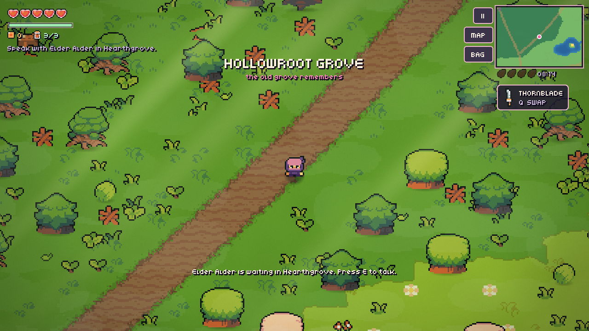
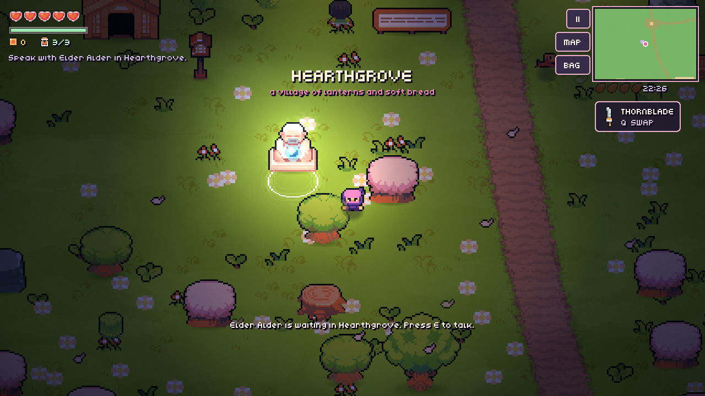
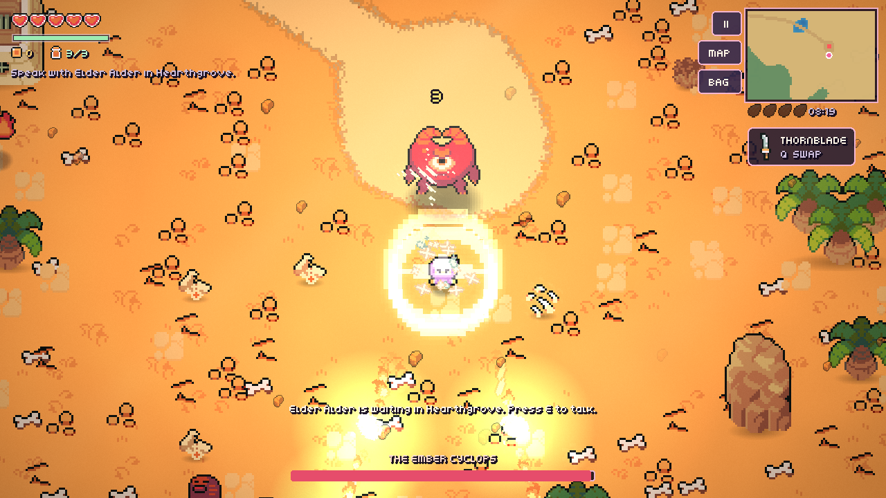
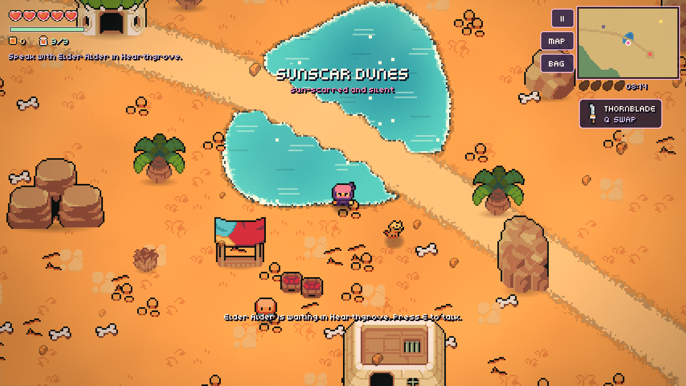
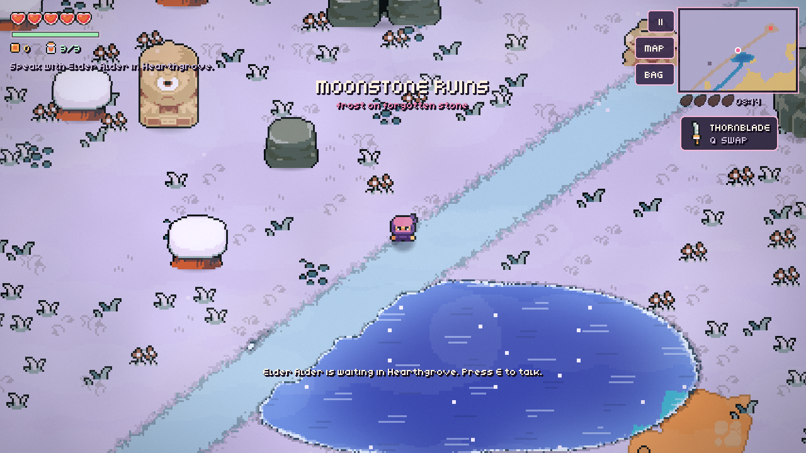

# Petalbound

An offline, landscape **open-world pixel-art action adventure** for Godot 4 (Android first, keyboard and gamepad supported). Mallow, a rose-haired wanderer in a plum cloak, sets out from the lantern village of Hearthgrove across a 4,864 × 2,816 px valley of seven biomes. The goal is to win back four Moonseeds from the region guardians, wake the dimming Moonwell — and then, if you dare, climb down into the Blighted Depths.



| | |
| --- | --- |
|  |  |
|  |  |

## Play

Open `project.godot` in Godot 4.3 or newer (validated on 4.7.2). The game uses the **Compatibility renderer**, a 640×360 pixel viewport (aspect expand), and sensor landscape orientation.

| Action | Keyboard | Gamepad | Touch |
| --- | --- | --- | --- |
| Move | WASD / arrows | Left stick / D-pad | Floating joystick (lower left) |
| Sprint (uses stamina) | Shift | L2 | SPRINT button, or push the stick to its edge |
| Roll (i-frames, early-window parry) | Space | B | Roll button |
| Jump (hop low props, plunge attack) | C / L | Y | Jump button |
| Attack / combo / charge bow | J / K / Enter | A / X | Large weapon button |
| Swap weapon | Q / Tab | R1 | Weapon button |
| Mothlight · Petalguard · Moontea | F · G · R | L1 · R2 · – | Skill buttons |
| Talk / open / rest / gather / fish | E | A | Context button |
| Satchel (equip gear) · World map | I / B · M | Select | BAG · MAP |
| Photo mode (drag to pan, zoom, capture) | F9 | – | Pause menu → PHOTO MODE |
| Pause / settings | Esc / P | Start | ❚❚ |

## What's in the world

- **Open world.** A seeded generator (`tools/generate_world.py`) builds six biomes: Petal Meadow, Hollowroot Grove, Sunscar Dunes, Moonstone Ruins, Glasswater Marsh and the southern coast — and at runtime the world grows a scripted seventh biome, **Starfall Rise**, east of the dunes: 48 extra tiles of white groves, the Mirror Basin lake with its island, the Starfall Watch pillar ring, its own waystone, a stargazing monk, new monster camps and three treasure chests. The world has roads, rivers, lakes, about 2,080 collidable props, about 9,700 decor sprites, 187 monsters in packs, 17 villagers and animals, 16 chests, 6 waystones and 4 boss arenas. Mallow can swim in deep water.
- **Mallow's movement kit.** Mallow can walk, sprint with stamina, dodge-roll with afterimages and invulnerability, and jump over low props with a landing plunge. Mallow also swims, pushes against obstacles, and plays item-get poses. Dust, ripple and footstep effects follow each move.
- **Combat.**
  - Four weapons:
    - Thornblade: 3-hit combo.
    - Bloomstaff: homing bolt.
    - Gale Bow: charge shot.
    - Ironroot Hammer: shockwave.
  - Three skills: Mothlight burst, Petalguard shield, and Moontea heal.
  - **Perfect parry:** if an attack lands during the first half of a dodge-roll, Mallow parries it — a burst of petals, refunded stamina, a shockwave that staggers everything nearby, and no damage taken (2 s cooldown).
  - Hits have hit-stop, knockback, damage numbers, screen shake and dissolve deaths.
  - 19 monster types use five AI styles (hopper, chaser, flyer, caster, charger), each with wind-up tells.
- **Fishing.** Pip in Hearthgrove sells the Willow Fishing Rod (60 Petalcoins). Face any water and press E to cast, then ATTACK when the bobber jolts. Four species: Dewfin, Redbreast, the night-only Moonkoi, and the Starfin that only bites in Starfall Rise. Every catch converts instantly to Petalcoins and is logged in the satchel.
- **Nightlife.** When the sun sets, moonpetals open along the water — gather them to refill Moontea and earn coins. Night wisps rise at fixed spots and fade at dawn, and Hearthgrove's villagers drift to their own night anchors.
- **Guardians.** There are four bosses: the Briarback, the Glasswater Toad, the Ember Cyclops and the Quiet Warden. Each mixes charge, leap, spread, ring, spike and teleport patterns, and each enrages at half health. Fights show a boss bar and ground telegraphs.
- **The Blighted Depths.** After the ending, interact with the Moonwell twice to descend into a wave arena: endless monster waves under the well, and every fourth wave a boosted guardian echo (with new rewards at depth 5 and 10). Waves pay Petalcoins; your best depth is tracked per save.
- **The moth companion.** At your first Moonseed a little moth joins you. It glows at night and, when you stand still, drifts toward the nearest unopened chest.
- **Feats.** 18 achievements (first kill, full arsenal, all chests and waystones, every fish, five moonpetals, ten parries, Depths milestones, reaching Starfall Rise, and more) pop as HUD toasts and are listed in the satchel's FEATS page.
- **Photo mode.** Press F9 (or the pause menu's PHOTO MODE) to freeze the world, hide the HUD, drag-pan the camera, zoom, and save a screenshot to `user://photos/`.
- **Gear and economy.**
  - Gear: Plum Wayfarer Cloak, Moonheart Charm, Briar Mail, Zephyr Boots and Ember Ring. Equipping armour or boots also changes Mallow's outfit.
  - Heart Blooms raise maximum health. Petalcoins drop from enemies and breakable pots and grass.
  - Pip in Hearthgrove and a desert nomad run shops.
- **World systems.**
  - An 8-minute day/night cycle includes lit lanterns, statues, waystones and Mallow's own lantern at night.
  - Each region has its own tint, fog, light rays and weather (petals, leaves, sand, snow, rain, fireflies).
  - The blight desaturates the world, and colour returns as Moonseeds come home.
  - Each region has its own music, plus ambient loops and a pooled SFX player.
  - Autosave every 45 s, plus saving at waystones.
- **Rendering.** Custom shaders handle the ground blend (biome palette blending, animated water with shoreline foam), foliage wind sway, sprite hit-flash and dissolve, atmosphere (fog, god-rays, vignette) and a post-process pass (soft bloom, colour grade, saturation). A low-FX quality toggle is in Settings.
- **Interface.** The HUD uses the Kenney Mini pixel font and shows:
  - Hearts, stamina, coins and tea, and the current quest.
  - A minimap, a full world map, the day clock and region banners.
  - Typewriter dialogue, the shop, the satchel, the FEATS page, the pause/settings menu, and photo mode.
  - Settings cover joystick dead zone and sensitivity, music and SFX volume, FX quality and touch-control visibility.
  - Multi-touch buttons work while the joystick is held.

## Headless checks

```sh
godot --headless --editor --path . --quit          # import + parse
for t in tests/*.gd; do godot --headless --path . -s "$t"; done
```

There are six smoke tests:
- `adventure_slice_smoke`: world, movement, combat, loot, gear, dialogue, guardians, ending, save/load and respawn.
- `content_smoke`: the Starfall expansion, fishing, moonpetals and wisps, perfect parry, the Blighted Depths, the moth, feats, photo mode and the new save keys.
- `player_facing_smoke`
- `virtual_joystick_smoke`
- `touch_buttons_smoke`
- `world_bounds_smoke`

Tests write to a separate `user://petalbound_test_save.json`.

To rebuild the world data, run `python3 tools/generate_world.py && python3 tools/preview_world.py`. This needs numpy, scipy and Pillow. The preview is written to `docs/world_map.png`. Starfall Rise is generated deterministically at runtime (seed 20261012), so `world.json` regeneration stays compatible with the expansion.

**Not tested on a phone.** Real Android touch feel, notch/safe-area behaviour, thermals and sustained frame rate have not been verified in this environment.

## Credits

The art, animation, sound and music come mainly from **Ninja Adventure** by Pixel-boy & AAA (CC0). The UI font is from **Kenney Fonts** (CC0). The earlier Mini Meadow and RPG icon packs are kept as well. Full details are in [`assets/packs/ASSET_CREDITS.md`](assets/packs/ASSET_CREDITS.md).

## Automation

For phase-by-phase development runs, see [`AUTOMATION_PROMPT.md`](AUTOMATION_PROMPT.md).
